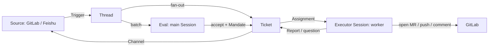
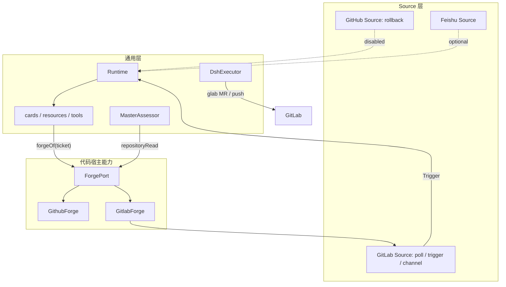

# 基于 GitLab 落地 dsh-superagent：方案与实施计划

> 分析对象：`dsh-superagent-prototype`（DSH 上的“单仓库主动式编码智能体”研究原型）。
> 目标：把当前以 GitHub 为唯一代码协作面的 superagent，落成一套 **以 GitLab 为代码宿主、可治理、可回滚、可复制到多个项目** 的体系。
> 结论基于源码通读（约 6.4k 行 docs/src 核心）与 GitLab 官方文档核对；标 **【事实】** 的是代码/文档事实，标 **【建议】** 的是设计判断，标 **【需实测】** 的是依赖实例版本/许可证、必须在目标 GitLab 上验证的行为。
>
> 三份支撑性深挖笔记：`.artifacts/gitlab-landing/01-source-layer.md`（源层映射）、`02-core-and-forge-abstraction.md`（通用层耦合与接口）、`03-deployment-ops-tests.md`（配置/部署/面板/测试）。本文是综合判断，个别人日与优先级以本文为准。
>
> **执行进度**：PR 1.1–1.5、Phase 2.1–2.9、Phase 3（GitLab 提示词/技能）与 Phase 4 的 review-gate/canary 已落地。剩余真实项目试点与部署文档，任务见 [Phase 1/2 执行清单](2026-11-19-gitlab-phase1-2-execution-plan.md)。

---

## 0. 一页结论

**推荐路线：不改造 `github.ts`，而是“新增 GitLab Source + 抽出 Forge 能力 + 保留 GitHub 可回滚”。**

具体是四件事：

1. **把“代码托管平台”抽成能力（ForgePort）**：PR/MR 绑定、CI、仓库文件读取、终态通知、深链，从通用层（`cards.ts`、`tools/executor.ts`、`runtime.ts`、`assessment.ts`、`resources.ts`）里移出去，由 SourceKind 声明。见 §2.2、§4。
2. **新增 `gitlab` Source kind**：Issue/MR、Notes/Discussions、Approvals、Pipeline 翻译成现有 Trigger/Thread/Channel；**v1 轮询为主**，todos/events 做唤醒与兜底，webhook 后置。见 §3。
3. **把提示词/技能从“GitHub 专用”改成“代码宿主中立 + 每个 Source 一份技能”**。这是最容易被低估的工作量：提示词就是产品行为，不是附属文案。见 §5.1。
4. **治理门禁按 Free 版设计，合并权放在宿主侧**：受保护分支 + MR pipeline 里的 `review-gate` job + “Pipelines must succeed” 是基础；**D5 已选择让智能体执行合并，因此 worker token 不给合并权限，宿主在“非作者 approval + 绿 pipeline + 门禁通过”后调用 merge API**。这不是“无审批合并”，见 §5.2.1。

**不推荐的做法**（已排除）：

| 做法 | 为什么不做 |
| --- | --- |
| 在 `github.ts` 里加 `if (kind === 'gitlab')` | Thread 键、channel 地址、部署模型、环境变量都假设 GitHub；分支会扩散到 10+ 个通用模块，测试矩阵翻倍。 |
| 做一个 GitHub API 兼容网关，把 GitLab 包成 GitHub | 语义对不齐（issue/MR iid、approval、pipeline、notes/discussions），且多一层运维故障点；调试时无法判断是网关还是 agent 的问题。 |
| 只做 webhook、不做轮询 | GitLab 的 webhook 需要入站可达；本插件管理 API 强制 loopback（`src/app/http.ts:231`），且 webhook 会重试/乱序。轮询是必须的兜底。 |
| 让 worker 自己拿 token 去 merge | Free 版 approval 不是必须的，`.gitlab-ci.yml` 又对 worker 可写；worker 可以删掉 `review-gate` job 再用 “Pipelines must succeed” 通过。合并权必须留在宿主侧（§5.2.1）。 |
| 一上来做多项目/群组级实例 | 当前 `SourceRegistry` 一个 kind 只有一个实例（`src/sources/registry.ts:45-49`），多项目需要改实例模型；先用“一进程一项目”验证价值。 |

**规模判断**：

| 形态 | 人日（1 名熟悉该仓库的工程师） | 日历周期 | 说明 |
| --- | --- | --- | --- |
| 单项目 MVP（能接单、开 MR、智能体在门禁后合并） | **28–35** | 4–6 周 | 含 Forge 抽象、GitLab Source、GitLab-only 提示词、最小门禁、宿主侧合并 |
| 单项目生产可用（可靠性 + 审计 + 运维） | **33–43** | 6–8 周 | 含 canary、429/404 处理、token 轮换、回滚演练、宿主合并审计 |
| 多项目/群组体系 | 再 **+10–15** | 再 2–3 周 | 需要改 Source 实例模型或采用 N 进程部署 |

**关键决策**（详见 §10）：D2/D3/D4/D5/D6/D7/D8 已锁定；D1 的 self-managed/gitlab.com 在 Phase 0 确认（Free 已定）。工作量会因 D3 的自动范围、D5 的宿主合并实现方式在 28 到 45 人日之间摆动。

---

## 1. 基线：这套系统到底是什么

### 1.1 运行链路



- **域模型**（`docs/001-domain.md`）：Source 产生 Trigger，Trigger 落到 Thread，Eval 判断是否接单，接单生成 Ticket + Mandate，Assignment 把 Ticket 交给 Executor，Executor 在独立目录/独立 Session 里干活，结果通过 Channel 回到 Source。
- **主 Session**（`orchestrator`）负责评估、路由、派工、回复；**Executor Session**（`worker`）负责实现、测试、开 MR、回答追问。
- **代码宿主不是抽象概念，是贯穿层**：PR 绑定决定 Ticket 何时结束（`src/core/tickets.ts:77-90`），CI 是评估输入，仓库文件读取是评估工具，终态通知走 Channel。

### 1.2 GitHub 绑定在五层，不只是 Source

| 层 | GitHub 假设 | 证据 |
| --- | --- | --- |
| Source 实现 | Issue/PR/comment/review/CI 翻译、notifications 轮询、mention sweep、quarantine | `src/sources/github*.ts` 共约 1,000 行 |
| 部署与 setup | 单仓库 `owner/name`、单账号 `gh`、`permissions.push`、`users.noreply` 邮箱 | `src/deployment.ts:45-57,87-105`；`src/app/setup.ts:64,79` |
| 传输与执行环境 | `gh api repos/<repo>/...`、`GH_CONFIG_DIR`、`credential.https://github.com` | `src/infra/commands.ts:75-98`；`src/infra/environment.ts:18,47,100,111-112` |
| 通用业务层 | `pullOf` 出现在 ticket card；`pr_number` 出现在 worker 工具；终态通知从 `github-pull.ts` 直接调；评估器读仓库走 GitHub API | `src/app/cards.ts:4,30`；`src/app/tools/executor.ts:82`；`src/app/runtime.ts:36,151`；`src/app/assessment.ts:266`；`src/app/resources.ts:209` |
| 提示词/技能/面板 | `gh`、PR、`[bot]`、`users.noreply.github.com`、`skill/github`、面板图标 | `prompts/*.md`、`skills/dsh-superagent-github/SKILL.md`、`src/client/locales.ts`、`src/client/ticket.tsx:178` |

**关键判断**：Source 本身可以“另写一份”，但**部署模型、执行环境、Ticket 结束判定、CI/仓库读取、提示词**这五处必须一起处理，否则 GitLab 只能“半通”：能收消息，但开不了 MR、结束不了 Ticket、worker 不知道用 `glab`。

### 1.3 已有资产与已知短板

源码里已经有三块可直接复用的可靠性资产（`docs/010-reliability.md`）：

- **提及回看 + 仓库级扫描**：游标回退 900 秒，Trigger ID 确定性去重（`src/sources/github.ts:459-490`）。
- **Thread 隔离**：连续 404 达到阈值后 `pollSuspended`，避免一个删除的 Issue 把整个 Source 拖红（`src/sources/github.ts:492-526`）。
- **Session 启动预检**：`scripts/session-preflight.py` 隔离损坏的 session 目录。

但 2026-11-06 的实战评估（`reports/2026-11-06-xiangzi-agent-superagent-capability-review.md`）暴露了三个必须带进 GitLab 版本的问题：

1. **接单可靠性是最大短板**：通知索引延迟导致 3 条提及在同两分钟内丢失，`#257` 人工等待 4 小时 36 分。GitLab 没有 notifications 等价物，**这个问题只会更严重**，必须在源层设计里正面解决（§3.6）。
2. **“人工 review”在实际运行中没有发生**：5 个 PR、0 条 review、0 条评论，CI 绿即合并。GitLab 版本必须把“审批”做成**可验证的门禁**，而不是提示词里的一句话（§5.2）。
3. **运行层脆弱**：一个删除的 Issue 长期污染健康；一个损坏 session 阻断启动。GitLab 版本要把 404/429/301、token 过期、项目迁移都当作一等故障处理。

---

## 2. 目标架构

### 2.1 总体形状



### 2.2 关键设计 1：ForgePort 放在 `src/sources/forge.ts`

**不放 `src/core/ports.ts`**。原因：`ports.ts` 是“core 依赖的端口”，成员都由 app 实现且不含网络；把 PR 编号、CI 快照放进 core，会让领域层知道代码托管平台，违反 `docs/001` 的“只保留工作需要的概念”。放 `src/sources/` 与现有 `kind.ts`/`host.ts` 同层，app 可以依赖它，Source 实现可以注册它。

建议接口（精简到当前真正被跨层消费的能力）：

```ts
// src/sources/forge.ts —— 类型与纯函数，供 Source 实现与 app 共用
export type ChangeKind = 'change'   // GitHub PR / GitLab MR
export interface ChangeRef { kind: ChangeKind; number: number }  // GitLab 为 MR iid
export interface ChangeSnapshot {
  ref: ChangeRef
  state: 'open' | 'merged' | 'closed' | 'locked'
  url: string
  authorId: string
  headSha?: string
  headBranch?: string
  baseBranch?: string
  sameProject: boolean            // GitLab: source_project_id === target_project_id
  draft?: boolean
  mergedAt?: string
  closedAt?: string
  autoMerge?: boolean             // GitHub auto_merge / GitLab merge_when_pipeline_succeeds
  approvals?: { approvedBy: string[]; required?: number }
  pipeline?: { status: string; id?: number; url?: string }
}

export interface ChangeBinding {
  /** 解析 Thread 键中的 MR/PR 编号；不是变更线程时返回 undefined。 */
  parse(thread: string): ChangeRef | undefined
  /** 读一个 MR/PR。 */
  read(ctx: SourceContext, ref: ChangeRef, signal?: AbortSignal): Promise<ChangeSnapshot>
  /** 校验并绑定到 Ticket；拒绝时返回一句给模型看的原因。 */
  claim(ctx: SourceContext, ticketId: string, change: ChangeSnapshot): string | undefined
  /** 轮询后对账：合并/关闭时调 threadClosed，返回是否已结束。 */
  observe(ctx: SourceContext, change: ChangeSnapshot): Promise<boolean>
  /** Ticket 当前跟随的变更编号，openOnly 时排除已关闭。 */
  numbersOf(ticket: Pick<Ticket, 'follows'>, openOnly?: boolean): number[]
  /** 发给非代码宿主渠道的终态通知。 */
  terminalNotices(ticket: Ticket, request: string): OutboundMessage[]
}

export interface ForgePort {
  readonly kind: string
  readonly changeWord: Localized        // PR / MR
  pageUrl(project: string, ref: ChangeRef): string
  readonly change: ChangeBinding
  readonly checks?: { /* CI 快照、摘要、ThreadFact */ }
  readonly repositoryRead?: { read(ctx, path, kind): Promise<string> }
}
```

`SourceKind` 增加：

```ts
export interface SourceCapabilities { forge?: ForgePort }
export interface SourceKind<C> { /* ...现有字段 */ capabilities?: SourceCapabilities }
```

`SourceRegistry` 增加 `forgeOf(ticket | threadKey)`、`capabilities(sourceId)`。GitHub kind 把现有 `github-pull.ts`/`github-read.ts` 包成 `ForgePort`，**行为不变**；GitLab kind 实现同一接口。

**收益**：`cards.ts`、`tools/executor.ts`、`runtime.ts`、`assessment.ts`、`resources.ts` 不再直接 import `github-*`；新增一个代码宿主是纯适配器，不需要再改五处。

**代价**：约 4–6 个可独立合并的 commit；必须用 golden test 锁住 GitHub 旧输出（见 §7）。

### 2.3 关键设计 2：v1 只允许一个“活跃代码宿主”

当前 `Deployment.repository` 是单值（`src/deployment.ts:54`），`Commands.path()` 直接拼 `repos/<repository>/`（`src/infra/commands.ts:94-98`），worker 环境变量也是单命名空间（`src/sources/github.ts:96-108`）。如果 GitHub 和 GitLab 同时启用，两个 Source 会争夺同一个 `Deployment`，提示词也无法同时说 `gh` 和 `glab`。

**v1 决策：【建议】一个部署只有一个活跃代码宿主**：

```yaml
# 示意
sources:
  gitlab: { enabled: true,  config: { host: https://gitlab.example.com, project: group/app, cli: /opt/agents/glab } }
  github: { enabled: false, config: { ... } }   # 插件保留，配置保留
```

- GitLab 启用时，`Deployment.forge.kind = 'gitlab'`；`Setup` 按启用状态解析 GitLab，GitHub 配置原样保留。
- 回滚 = 关闭 `gitlab`、启用 `github`、重启；数据库与 `github-*` KV 键不动。
- **双活**（同一实例同时服务 GitHub + GitLab）需要 `Deployment.accounts` 按来源、`Commands` 按 forge 分派、提示词按来源注入、环境变量按 host 写凭据。这是 Phase 5 的事，不要在 v1 承诺。

### 2.4 关键设计 3：GitLab Source 的传输

**用 `glab` 而不是裸 REST**，与现有“子进程 + CLI 身份隔离”的模型一致：

- `glab api --paginate` 在 JSON 模式输出**单个扁平数组**（不是 `gh --slurp` 的数组的数组），`pages()` 可以一次解析。【已核实：[glab api](https://docs.gitlab.com/cli/api/)】
- `glab api --include` 可读响应头（`x-next-page`、`RateLimit-*`）；`--hostname` 显式指定实例；`GITLAB_HOST`/`GITLAB_TOKEN` 可用，但 token 建议放包装脚本的 `GLAB_CONFIG_DIR`，不要进 worker 环境。【已核实：[glab configuration](https://docs.gitlab.com/cli/configuration/)】
- `glab auth login --setup-git-credential-helper` 可把 glab 配成 git 凭据助手；worker 的 `worker-gitconfig` 仍应显式写 `credential.https://<host>.helper`，并用 `GIT_SSL_CAINFO`/`GLAB_CA_CERT` 统一自签 CA。【已核实：[glab auth login](https://docs.gitlab.com/cli/auth/login/)；需实测目标版本】

**Commands 的改法**：不动 GitHub 的 `api()/pages()`，新增 `gitlabApi()`/`gitlabPages()`，用**数字 project id**（setup 解析）构造 `projects/<id>/...`，保留现有越界检查（拒绝绝对路径、`..`、scheme）。这是唯一防止 worker 调别的项目的边界，不能只换前缀。

### 2.5 关键设计 4：GitLab Source 的轮询模型

```text
每轮（默认 60s，可配 120s）：
1. todos（pending）        —— 唤醒信号：哪个 iid 有新动静，去读一次
2. project events（可选）  —— 新 Issue/MR/comment 的加速器；DiscussionNote 不全，不能当唯一来源
3. 仓库流（可开关）        —— issues / merge_requests 按 updated_after 增量
4. 订阅 Thread             —— 每个 Thread 读 notes/discussions 首页，按 updated_at/id 截断
5. 开放 Ticket 的 MR       —— 读 MR 状态、approvals、head pipeline
6. mention 兜底（默认关）  —— 有界扫描最近更新的 Issue/MR，再逐个读 notes；1+N 成本
```

**为什么不是“todos 为主”**：todos 只覆盖 assigned / mentioned / directly_addressed / approval_required / build_failed / unmergeable 等动作，**不是全量评论流**；用户在 Web UI 读过就不再 pending。【已核实：[To-Do List API](https://docs.gitlab.com/api/todos/)】所以 todos 只能当“加速器”，订阅 Thread 轮询才是真相来源。

**为什么保留 events**：`GET /projects/:id/events` 支持 `target_type=merge_request`、`note`，能覆盖大部分“谁在什么时候评论/开了 MR”的活动；但 `DiscussionNote` 不进 Events，且没有精确游标。【已核实：[Events API](https://docs.gitlab.com/api/events/)】因此只做加速，不做唯一来源。

### 2.6 关键设计 5：v1 的部署形态

- **一进程一项目**：`stateDir` 独立、SQLite 独立、故障域独立；沿用 `scripts/dsh-superagent` 的 tmux/服务管理。
- 每个项目一个 GitLab Source 实例、一个 `glab` 包装脚本、一个 project access token。
- 管理 API 仍只监听 loopback；**webhook 后置**（需要反向代理 + `X-Gitlab-Token` 校验 + 独立路由，不要暴露 `/orchestrator/api/`）。
- 监控：`GET state` 的 health、`scripts/dsh-superagent status`、mention canary（GitLab 版）。

---

## 3. GitLab 映射：事件、Thread、Channel、MR、审批、CI

### 3.1 事件面

| 能力 | GitHub 现状（证据） | GitLab 方案 | 差异/风险 |
| --- | --- | --- | --- |
| 通知 | `GET notifications?all=true&since=`（`github.ts:308-364`） | **无对等物**；`GET /todos?state=pending` 做唤醒；订阅 Thread 轮询为主 | todo 不是全量评论流，读过后消失 |
| 新 Issue/MR | `issues?state=all&sort=updated&direction=asc&since=`（`github.ts:177-253`） | `GET /projects/:id/issues?state=all&order_by=updated_at&sort=asc&updated_after=`；MR 换 `merge_requests?scope=all` | GitLab 无 ETag/304 保证；游标在整批 `receive` 后推进 |
| 评论 | `issues/comments`、`pulls/comments`、`pulls/reviews`（`github.ts:407-426`） | `GET .../issues/:iid/notes`、`.../merge_requests/:iid/notes`；行内评论用 `.../discussions`（`DiffNote`） | notes 无 `since`/`updated_after`，每轮按首页 + 本地截断 |
| 行内讨论 | 按 `in_reply_to_id` 聚根（`github-read.ts:85-96`） | `discussions`：`discussion_id` 是字符串，`notes[].position` 有 path/line | channel 地址必须带 `discussionId` |
| 审批 | 无独立流，review `state` 走评论路径（`github-trigger.ts:54-59`） | `GET /projects/:id/merge_requests/:iid/approvals` 的 `approved_by` 差量；合成 `human:true` Trigger | 系统注释也有 “approved”，不要重复计 |
| 默认分支 CI | `pollBranchCi` + check-runs/statuses（`github.ts:255-276`；`github-read.ts:60-70`） | `/pipelines?ref=<branch>` → `/pipelines/:id/jobs`；或 `repository/commits/:sha/statuses` | `manual`/`blocked` 是“等人”，不是失败；`allow_failure` 要排除 |
| MR CI | `pollChecks` 按 head sha（`github.ts:427-447`） | `head_pipeline` 或 `/merge_requests/:iid/pipelines` | 重试产生新 pipeline id，指纹要含 id/sha/status |
| mention 扫描 | 仓库级 comments 列表（`github.ts:459-490`） | **无项目级 notes 列表**；只能 updated_after 枚举 + 逐条读 notes（1+N） | 默认关或严格限流；成本最高的项 |
| 删除/失权 | 404 退避 → quarantine；410 → dropped（`github.ts:492-526`） | 404 同义；**429 绝不计入 thread 失败**；项目迁移是 301 | 429 误隔离会拖红健康 |

### 3.2 Trigger / Thread / Channel 的稳定映射

**最重要的结构性差异：GitLab 的 Issue iid 与 MR iid 是两套独立序列**（GitHub 共享 `number`）。因此：

| 概念 | GitHub | GitLab |
| --- | --- | --- |
| Thread 键 | `github:12` | `gitlab:issue:12`、`gitlab:mr:12`（类型前缀由 id 承担，`threadKey` 仍是 `${source}:${id}`） |
| Trigger id | `github-issue`/`github-comment`/`github-ci` + number | `gitlab-item`/`gitlab-note`/`gitlab-approval`/`gitlab-ci` + kind + iid + 版本 |
| Channel address | `{ number, url? }` | `{ kind, iid, noteId?, discussionId?, url? }` |
| MR 解析 | `Number(thread.slice('github:'.length))`（`github-pull.ts:18`） | `parse('mr:12')`，只认 `mr` 前缀 |
| `find()` | `#12`/`12`/URL → `github:12` | `#12` → issue、`!12` → MR；URL 支持 `/-/issues|merge_requests/` 与子组路径 |
| 正文 Trigger | `key('github-issue', number)`（`github-trigger.ts:84`） | `key('gitlab-item', kind, String(iid))` |
| MR head ref | `refs/pull/<n>/head` | `refs/merge-requests/<iid>/head` |

**Trigger 形状（建议）**：

```ts
const itemThread = (kind: 'issue' | 'mr', iid: number) => `${kind}:${iid}`

export const noteTrigger = (note: GitlabNote, ref: { kind: 'issue' | 'mr'; iid: number }, agent: string): Trigger => ({
  id: key('gitlab-note', ref.kind, String(ref.iid), String(note.id), note.updated_at ?? ''),
  source: 'gitlab',
  threads: [{ source: 'gitlab', id: itemThread(ref.kind, ref.iid) }],
  actor: { source: 'gitlab', id: note.author.username },
  human: isHumanUser(note.author) && note.author.username !== agent,
  at: note.updated_at ?? note.created_at,
  text: noteBody(note),                 // system note 单独处理，不直接当人类消息
  ...(mentions(note.body ?? '', agent) ? { addressed: 'mention' as const } : {}),
  channel: gitlabChannel(ref.kind, ref.iid, { noteId: note.id, discussionId: note.discussion_id }),
  meta: { item: ref.kind, iid: ref.iid, event: 'note', noteId: note.id, system: note.system ?? false },
})
```

### 3.3 MR 生命周期与 Ticket 结束

GitLab MR `state` 有 `opened / closed / locked / merged`。**只有 `merged_at` 或 `closed_at` 才能触发 `threadClosed`**（`src/core/tickets.ts:77-90`）：

| GitLab 事实 | 是否结束 Ticket | 去向 |
| --- | --- | --- |
| `state=merged` / `merged_at != null` | 是，`outcome='merged'` | `ctx.tickets.threadClosed(ref, 'merged', merged_at)` |
| `state=closed` + `closed_at` | 是，`outcome='closed'` | `threadClosed(ref, 'closed', closed_at)` |
| `state=locked` | **否**（只是讨论锁定/过渡态） | 不改 Ticket |
| `draft` | 否 | Thread fact；门禁可跳过 |
| pipeline failed | 否 | CI Trigger / fact |
| approval 变化 | 否 | 审批 Trigger / fact |
| auto-merge 开关 | 否 | Thread fact |

`Follow` 的 `own` 与 `followsDone` 可原样复用，前提是 MR 的 Thread 键能被 `change.parse` 正确识别为 `own`。

### 3.4 审批与 pipeline 语义

- **审批**：`/approvals` 返回 `approved_by`（用户列表）、`approvals_required`、`approvals_left`；Free 可 approve/查询，但**required approvals / approval rules 是 Premium**。【已核实：[Merge request approvals](https://docs.gitlab.com/user/project/merge_requests/approvals/)】审批人变化合成 `human:true`、无正文的 Trigger（类似 GitHub 的无正文 review），可唤醒等待评审的 worker。
- **系统注释**：GitLab 的 `system:true` note 包括 label/状态/审批变化。**不要直接 ingest**，否则会和审批轮询重复；合并/关闭只更新状态并调 `threadClosed`；审批优先读 `/approvals` 结构化字段。
- **Pipeline**：状态 `created/waiting_for_resource/preparing/pending/running/success/failed/canceled/skipped/manual/scheduled`。`failed/canceled` 算失败；`manual/blocked` 是“等人操作”，算 running 或单独标注；`allow_failure:true` 的 job 不计失败。
- **auto-merge**：GitLab 的 `merge_when_pipeline_succeeds` 会遵守项目 merge checks（含 required approvals、pipeline、discussion resolved）。【已核实：[Auto-merge](https://docs.gitlab.com/user/project/merge_requests/auto_merge/)】但在 Free 版审批不是必须的，**所以门禁必须由 CI job + 宿主侧合并门禁兜底**（§5.2.1）。

### 3.5 身份、授权、bot

`github.login` 在代码里有 10 个用途（过滤自己、`@` 提及、`[bot]` 判断、`agentPull`、回复去重、提交邮箱、面板显示等，见 `github-trigger.ts:46-63`、`github-pull.ts:25`、`github-channel.ts:35`、`deployment.ts:105`）。GitLab 对应：

- `/user` 返回 `id`、`username`、`name`、`state`，部分版本有 `bot`；project/group access token 创建的是 **bot user**（username 常形如 `project_123_bot_abc`）。
- **没有 `[bot]` 后缀约定**：`isBot` 由 kind 实现（GitHub 保留 `[bot]$`；GitLab 用 `bot === true` 或 `_bot_` 命名/`state !== 'active'` 兜底）。
- **提交邮箱没有 GitHub 的 `id+login@users.noreply.github.com` 公式**：必须新增 `commitEmail` 配置（服务账号邮箱，或 `users.noreply.<host>` 的私有提交邮箱）。**不要复制 GitHub 公式**。
- allowed 列表：GitHub 用 `^[A-Za-z0-9-]+$`，GitLab username 允许 `_`、`.`、`-`，正则放宽到 `^[A-Za-z0-9_.-]+$`；bot 允许 `group_123_bot_ab12`。身份仍不跨 Source 映射（`docs/001:32,39`）。

### 3.6 通知可靠性：正面解决“会丢消息”

GitLab 没有 GitHub notifications 的索引，但“丢消息”的根因是**游标越过晚到事件**。GitLab 版本的组合拳：

1. **游标回看**：`updated_after` 取 `now - lookback`（默认 900s），而不是严格 `now`；Trigger ID 去重保证重读安全。
2. **订阅 Thread 每轮必读**：不看 todo 是否丢，只要 Ticket 还订阅着，就轮询它的 notes/discussions。
3. **todos 唤醒**：pending todo 里的 `target.iid` 只用来“点名去读一次”，不直接生成 Trigger，避免 todo 语义泄漏进领域。
4. **project events 加速**：`target_type=note|merge_request|issue` 的增量，作为“谁刚评论了”的快速路径；DiscussionNote 缺失由 2 兜底。
5. **有界 mention 扫描（默认关）**：最近 N 个更新过的 Issue/MR，逐个读 notes；只在 canary 证明 todos+events 不够时打开。
6. **canary**：用测试项目跑“评论 @bot → 收到回复”的 20 次，p95 < 2 分钟才算过；这是上线门禁，不是可选项。

### 3.7 传输、认证、限流、CA

| 项 | 建议 |
| --- | --- |
| CLI | `glab` 包装脚本，`GLAB_CONFIG_DIR` 指向智能体专用配置目录，`GITLAB_HOST` 指向实例 |
| Token | **project access token（Developer，`api` + `write_repository`）**，有 `expires_at`，必须轮换；不要用个人 PAT 长期跑 |
| API | `glab api` + 数字 project id；`pages()` 解析单数组；需要头信息时 `--include` 手工 `x-next-page` |
| 429 | 读 `Retry-After` / `RateLimit-Reset`，作为下一轮 sleep 下限；**不计失败、不 quarantine** |
| 自签 CA | `GLAB_CA_CERT` + `GIT_SSL_CAINFO` 指向同一个 CA bundle；setup 时做一次 `git ls-remote` 连通性探测 |
| 项目迁移 | 301 跟随或使用数字 project id；不要判 `gone` |
| 限流 | 自建默认关闭认证 API 限流（开启时默认 7200/小时）；GitLab.com 有平台限制；轮询间隔 ≥60s，建议 120s【已核实：[rate limits](https://docs.gitlab.com/administration/settings/user_and_ip_rate_limits/)】 |

---

## 4. 代码级改造清单

### 4.1 新增

| 文件 | 职责 |
| --- | --- |
| `src/sources/forge.ts` | `ForgePort`、`ChangeRef`、`ChangeSnapshot`、纯函数（解析 Thread、`pageUrl`） |
| `src/sources/gitlab.ts` | kind 定义（schema/fields/facts/scope/policy/environment/find）、watch 循环、plugin entry |
| `src/sources/gitlab-trigger.ts` | Note/Issue/MR/User/Pipeline 的 zod schema、Trigger 构造、`gitlabAddress`、`mentions`、`isBot` |
| `src/sources/gitlab-mr.ts` | MR 绑定/观察/结束通知（`claim`/`observe`/`terminalNotices`） |
| `src/sources/gitlab-channel.ts` | notes / discussions 回复、marker 幂等、`gone` 判定、`link()` |
| `src/sources/gitlab-read.ts` | `threadContext`、pipeline/jobs 快照、`repository/files/:path/raw` |
| `src/sources/gitlab-api.ts`（可选） | 分页/头/429 的薄封装，避免 `Commands` 变成 if/else |
| `skills/dsh-superagent-gitlab/SKILL.md` | worker 的资源语法、discussion 回复、approval、pipeline、`glab` 命令 |
| `examples/gitlab/review-gate.mjs/.yml/.json` | GitLab 版门禁 job 与配置 |
| `scripts/apply-gitlab-review-gate.sh` | 受保护分支 + 审批设置 |
| `scripts/gitlab-mention-canary.mjs` | GitLab 版提及 canary |
| `tests/forge.spec.ts`、`tests/gitlab-*.spec.ts` | 见 §7 |

### 4.2 修改（按依赖顺序）

| 文件 | 改什么 | 量 | 阶段 |
| --- | --- | --- | --- |
| `src/sources/kind.ts` | `SourceCapabilities`、`capabilities?`；`ChannelLinks` 不再只认 `repository/feishu` | S | 1 |
| `src/sources/registry.ts` | `capabilities/forgeOf`；环境变量冲突校验 | S | 1 |
| `src/deployment.ts` | `Deployment.forge`（kind/host/project/projectId/cli/login/commitEmail）；`SETUP_FIELDS` 加 gitlab；`resolveDeployment` 拆成 `resolveGithub`/`resolveGitlab` | L | 1 |
| `src/app/setup.ts` | `resolve` 按启用 kind 分派；`checkAccounts` 按块分派；`setupFields` 覆盖 gitlab | M | 1 |
| `src/setup.ts` | `SetupPlace` 加 `'gitlab'`；新增 GitLab 错误码（类型必改，否则编译不过） | S | 1 |
| `src/infra/commands.ts` | 新增 `gitlabApi/gitlabPages`；保留 GitHub `api/pages`；`repos/` vs `projects/<id>/` 分派 | L | 1 |
| `src/infra/environment.ts` | `WORKER_COMMANDS` 加 `glab`；`worker-gitconfig` 按 host 写 credential/insteadOf；`agentVariables` 清除 `GITLAB_TOKEN`/`GLAB_*`；`verifyEnvironment` 参数化 | L | 1 |
| `src/sources/github*.ts` | 包成 `GithubForge`；`pullNumber` 改结构化 parse；行为不变 | M | 1 |
| `src/app/cards.ts` | `pullOf` → `registry.forgeOf(ticket)`；`pr_number` → `change`（保留 `pr_number` 别名过渡） | M | 2 |
| `src/app/tools/executor.ts` | `pr_number` → `change_number`（兼容）；宿主从 `github: SourceContext` 改为 `registry`；错误文案去 login | M | 2 |
| `src/app/runtime.ts` | 终态通知走 `forge.terminalNotices`；`get github` 改为 `get forge` | M | 2 |
| `src/app/assessment.ts` | `readRepositoryPath` → `forge.repositoryRead` | S | 2 |
| `src/app/resources.ts` | `github/` 前缀改为按来源；加 `gitlab/`；错误文案去 GitHub | M | 2 |
| `src/app/links.ts` | `#12`/`!12` 由各 forge 的 `find` 解释 | S | 2 |
| `src/app/tools/main.ts` | 示例中的 `github:123` 改中性 | S | 2 |
| `src/app/context.ts`、`prompts.ts`、`sessions.ts`、`skill-files.ts` | `sourceSkills` 从 `'feishu'|'github'` 扩展；`skill/gitlab` part；技能按来源注册 | L | 3 |
| `src/client/locales.ts`、`ticket.tsx`、`app.tsx`、`locale/*.json` | `source.gitlab`、`health.gitlab`、`problemSetupFix.gitlab`、`setup.*`、图标分支、描述去“单 GitHub 仓库” | M | 3 |
| `src/kv.ts` | 新增 `gitlab` 键族（`gitlab-since`、`gitlab-cursor:`、`gitlab-ci:`、`gitlab-todos`），**不要复用 `github-*`** | S | 2 |
| `prompts/*.md` | GitLab-only 重写（MR/`glab`），具体命令放 `skill/gitlab` | L | 3 |
| `cordis.patch.yml`、`package.json`、`tsdown.config.ts` | 新增 `dsh-superagent-gitlab` 插件（默认 disabled）、`./gitlab-watch` export、build entry | S | 2 |
| `docs/001,003,006,007,008,009,010`、`SETUP.md` | GitLab 词汇、环境变量表、模块/测试表、门禁、canary | M | 4 |

### 4.3 明确不改

- **`src/core/model.ts`、`tickets.ts`、`engine.ts` 的域逻辑**：`threadClosed` 的 `merged|closed` 已经够用；GitLab 的 `locked`/draft/pipeline/approval 都不该进结束判定。
- **`src/app/migration.ts` 的历史键**：只读兼容，不重命名；新增 schema 时不改旧语义。
- **管理 API 的 loopback + same-origin**：不要为了让 webhook 进来而放开；webhook 走独立路由 + token。

### 4.4 兼容、迁移、回滚

| 项 | 方案 |
| --- | --- |
| 旧数据库 | `Settings.sources` 是 record（`src/policy.ts:101`），新增 `gitlab` 键是纯增量；旧 `github-*` KV 原样保留 |
| 旧 GitHub 配置 | 保留 `source:github` 块与插件（`cordis.patch.yml` 不移除），只把 `enabled=false`；否则 registry 会显示 orphan 卡片（`registry.ts:47`） |
| 新部署 | 建议**全新 `stateDir`** 跑 GitLab 试点，避免历史 Trigger/Thread 与 GitHub 语义混在一起 |
| 回滚 | 关闭 `gitlab`、启用 `github`、重启；<10 分钟；数据库不迁移 |
| Prompt 回滚 | D6 选 GitLab-only；回滚要一并 revert 提示词（见 §5.1） |

---

## 5. 提示词、门禁与治理

### 5.1 提示词：这是“换产品行为”，不是换文案

`prompts/` 深度绑定 GitHub：`cli.md` 说“用 gh”；`team/delivery.md` 整段讲 `gh pr merge --auto`、`users/<login>` 反查 id、`Co-authored-by` 的 GitHub noreply 邮箱；`orchestrator.md`/`worker.md` 说“不要在 GitHub 上 merge/close”；`replies.md`、`subscriptions.md`、`dispatch.md`、`work.md`、`handoff*.md` 也都有 GitHub 词汇。`tests/cards.spec.ts` 还逐条断言这些句子。

**两条路线，D6 已选 B**：

| 路线 | 做法 | 成本 | 状态 |
| --- | --- | --- | --- |
| A. 平台中立 | 把“GitHub”改成“the code host / 代码宿主”，PR 改成 change（PR/MR），`gh` 改成“the CLI the Source skill names”；具体命令、`resolveReviewThread`、approval、pipeline 细节放进 `skill/github` 与 `skill/gitlab` | 4–6 人日 | 二期可选 |
| B. GitLab-only 重写 | 直接把 `prompts/` 改成 MR/`glab`，GitHub 仅保留代码可回滚 | 2–3 人日 | **本次采用（D6）** |

**D6 已选 B**：`prompts/` 直接改成 MR/`glab`，`cards.spec.ts` 的断言也改成 GitLab 词汇，不做平台中立化。这样 Phase 3 省 1–2 人日；代价是 GitHub 回滚时提示词要一起 revert，双 Source 同时运行时提示词不通用。A 作为二期演进。

必须逐项改的 GitLab 语义：

- **分支命名**：`agent/<ticket-name>` 不变；MR head ref 是 `refs/merge-requests/<iid>/head`。
- **开 MR**：`glab mr create --source-branch agent/<name> --target-branch main --title ... --description ...`；`--draft` 用于未完成。
- **评论/回复**：顶层用 `POST .../notes`；行内讨论用 `POST .../discussions/:id/notes`；**回复系统注释会 400**，要回退到 MR notes。
- **审批**：`/approvals` 读 `approved_by`；不要用“评论里说 approved”当批准。
- **合并**：D5 下 worker **不直接执行** `glab mr merge`；它调用 `orchestrator_merge_request`，由宿主校验后用 Maintainer token 执行（§5.2.1）。这样 worker 即使改了 `.gitlab-ci.yml` 也拿不到合并权。
- **原生 auto-merge（仅在明确需要时）**：`glab mr merge <iid> --sha <sha> --auto-merge -y`（`--auto-merge` 在 pipeline 运行时默认 true）；**取消必须用 API `cancel_merge_when_pipeline_succeeds`，绝不能用 `--auto-merge=false`（那会立即合并）**。【已核实：[glab mr merge](https://docs.gitlab.com/cli/mr/merge/)；取消端点【需实测】】
- **Co-authored-by**：GitLab 没有 GitHub noreply 公式；用 reviewer 的 commit email，未知时在 MR 描述里记录 `Reviewed-by: @username`，不要伪造邮箱。
- **`@` 提及**：GitLab username 允许 `.`，正则要放宽；不要复用 GitHub 的 `[A-Za-z0-9_-]+`。

### 5.2 Review gate：Free 与 Premium 两套

GitLab 的审批能力按 tier 分层：**Free 的 approval 是可选的，required approvals / approval rules 是 Premium**。【已核实：[Merge request approvals](https://docs.gitlab.com/user/project/merge_requests/approvals/)】因此门禁要分两层设计。

**共同的第一层：受保护分支 + 角色**

- `main` 设为 protected：`Allowed to merge = Maintainers`，`Allowed to push = No one`（或 Maintainers），禁止 force push。
- 智能体账号是 **Developer**：可以推 `agent/*`、开 MR，但**不能直接推 `main`、不能合并**。
- 开启 **“Pipelines must succeed”**（Free 可用，需 Maintainer 设置）；关闭 “Skipped pipelines are considered successful”。【已核实：[Auto-merge / require successful pipeline](https://docs.gitlab.com/user/project/merge_requests/auto_merge/)】

**第二层：MR pipeline 里的 `review-gate` job（Free 也能强制）**

- 在 MR pipeline 中运行（`rules: if $CI_PIPELINE_SOURCE == "merge_request_event"`）。
- 读 `GET /projects/:id/merge_requests/:iid/approvals`：至少 1 个**非作者** approval；是否覆盖 head SHA（若版本提供）。若目标实例 Free 的 `/approvals` 不返回 `approved_by`，退化为统计审批 Trigger/系统注释（需实测，不能默认可用）。
- 读 `GET /projects/:id/merge_requests/:iid/changes`（或 `diffs`）：新增+删除 > 200 行，或命中敏感路径（auth/oauth/audit/policy/approval/isolation/migrations），要求 2 个 approval。
- 不满足则 `exit 1`；配合 “Pipelines must succeed”，MR 不可合并。
- **Draft MR**：跳过尺寸/审批规则（允许早期迭代），但最终 MR 必须非 draft 才能合。
- **防绕过**：job 检查 `.gitlab-ci.yml` 是否被本 MR 修改；若是，要求额外审批或直接失败。更稳的做法是把门禁模板放在受保护的中央项目，用 `include: project:` 引入，智能体不能改模板。CODEOWNERS 是 Premium，Free 下用“CI 模板 + 保护分支”替代。

**Premium 增强**：

- 项目/组级 approval rules（1–2 approvals，按路径/大小无法原生表达，仍需 CI job）。
- CODEOWNERS 要求特定路径的 owner 批准。
- 外部 status checks（required status checks）替代部分 CI job 逻辑。

**管理员绕过**：GitLab 管理员/有 bypass 权限的人仍可强合；文档要写明“门禁是地板，不是天花板”，并用审计（`approved_by`、`merge_user`、`sha`、pipeline id）记录到 Ticket 终态与 IM 通知。

### 5.2.1 D5：智能体执行合并的落地方式（宿主侧合并权）

D5 已选择“智能体可直接合并”。按字面让 worker 自己 `glab mr merge` 在本仓库不可接受：Free 版 approval 不是必须的；`.gitlab-ci.yml` 对 worker 可写，worker 可以删掉 `review-gate` job，再让“Pipelines must succeed”通过。**因此把“合并权”从 worker 移到宿主**：

1. **两个 token，两个角色**
   - **worker token**：project access token，Developer，`api` + `write_repository`；可推 `agent/*`、开 MR、评论。protected `main` 的 Allowed to merge 只有 Maintainers，所以 worker 调 merge 会 403。
   - **host merge token**：独立 project access token（Maintainer）或专用 merge 账号；只放在宿主配置/`stateDir` 的 0600 文件，绝不进 worker 环境、`worker-bin/glab` 或 prepare 命令。
2. **一个工具**：`orchestrator_merge_request`（worker 调），参数只有 `mr_iid`、`head_sha`、`evidence`；不接受任意 API 路径，避免变成通用写接口。
3. **宿主门禁（可信代码，不依赖仓库 CI）**：
   - Ticket open 且 MR 绑定到它；`state=opened`；非 draft。
   - `approved_by` 至少 1 个非作者（>200 行或敏感路径要求 2 个）；approval 覆盖 `head_sha`（若版本提供）。
   - `head_pipeline.status=success`；无 `manual/blocked` 待办 job；`detailed_merge_status` 可合并；无未解决讨论（若项目要求）。
   - 本 MR 未修改 `.gitlab-ci.yml` / include 模板；若修改，要求额外 approval 或拒绝。
   - 全部通过才调 `PUT /projects/:id/merge_requests/:iid/merge`，带 `sha`、`merge_when_pipeline_succeeds=false`；否则把拒绝原因返回 worker，不合并。
4. **审计**：宿主把 `approved_by`、`merge_user`、`sha`、`head_pipeline.id/status`、diff 统计、门禁判定写入 Ticket/Thread facts 与终态通知；每周抽检“有 approval 的合并比例”。
5. **fail closed**：如果目标 Free 实例的 `/approvals` 不能证明非作者 approval，宿主**拒绝合并**，回退到人工合并；不因为“拿不到数据”就放行。

**边界**：这实现的是“智能体发起并完成合并动作”，不是“无审批合并”。如果你要的是连人工 approval 都不需要，那 `review-gate` 就退化成纯 CI 检查，本方案不支持、也不会写成默认。**残余风险**：宿主 merge token 泄漏、GitLab 管理员 bypass、approval 质量；前两者用 0600/轮换/审计和管理员约束缓解，第三者只能靠 CODEOWNERS（Premium）与人工 review 文化。

### 5.3 审计与身份分离

- **智能体（worker）**：project access token（Developer），只出现在 `worker-bin/glab` 的 `GLAB_CONFIG_DIR` 里；不进 worker 环境变量（DSH 会剥含 TOKEN 的变量，`src/infra/environment.ts:3-4,128`）。**没有合并 `main` 的权限。**
- **宿主合并身份**：独立的 Maintainer token/账号，只存在于宿主进程；执行 §5.2.1 的合并，不暴露给 worker。
- **reviewer**：人工账号，**绝不进 worker 环境**；在 GitLab UI 或 `glab` 里 approve。
- **审计字段**：MR `approved_by`、`merged_at`、`merge_user`、`sha`、`head_pipeline.id/status` 写入 Thread facts / 终态通知；每周抽检“有 approval 的合并比例”。

---

## 6. 落地路线图

### Phase 0：决策与探针（3–4 人日）

**目标**：把“能不能做”变成“按这个做”。

- 确认 GitLab 版本/tier（Free/Premium/Ultimate）、self-managed/gitlab.com、CA/代理。
- 在测试项目上跑 8 项探针（见 §7.4），特别是：`glab api --paginate` 输出、`/approvals` 可用性、`updated_after` 延迟、自签 CA、`glab auth git-credential`、`head_pipeline` 字段。
- D2–D8 已锁定（§10）；Phase 0 只确认 D1 的 self-managed/gitlab.com，并把 Free 实例的探针跑完。
- 基线指标：从现有 GitHub 部署取“接单 p95、ticket→MR 时长、合并率、review 数、健康红次数”；没有基线就定义目标。
- 产出：`ADR-001 GitLab Landing`（1 页），记录决策与否决理由。

**验收**：每个探针有命令、输出、结论；决策有 owner。

### Phase 1：Forge 抽象与部署骨架（5–7 人日）

**目标**：GitHub 行为不变，GitLab 有位置可插。

- 新增 `forge.ts`、`SourceCapabilities`、registry 访问器；GitHub 实现 `ForgePort`，但先不切换消费方。
- 切换 `cards/tools/runtime/assessment/resources` 到 registry；保留 `pr_number` 别名与 GitHub golden 输出。
- `Deployment.forge`、`resolveGitlab`、`Setup` 分派、`Commands.gitlabApi`、`environment` 的 glab shim/credential/CA。
- `gitlab` kind 骨架（schema/fields/health/plugin entry），默认 disabled；面板能渲染卡片。

**验收**：`pnpm check` 绿；GitHub 现有测试全绿；`source:gitlab` 卡片可见；保存错误配置显示 GitLab setup problem；回滚开关可用。

### Phase 2：GitLab Source MVP（8–10 人日）

**目标**：一个真实项目上跑通 issue → ticket → MR → 宿主门禁后合并。

- Trigger：Issue/MR 正文、Notes、DiffNote/Discussions、Approval 差量。
- Thread：`issue:<iid>`/`mr:<iid>`；Channel：顶层 note + discussion 跟帖 + marker 幂等 + `gone`。
- 轮询：todos 唤醒 + events 加速 + 订阅 Thread 首页 + 开放 Ticket 的 MR 状态/pipeline；游标原子推进；429/404/301 分开处理。
- 绑定：MR 的 `source_project_id`/`source_branch` 末段 = ticket 短名；一个 MR 只能绑一个开放 Ticket；合并/关闭调 `threadClosed`。
- **自动接单的确定性过滤（D3）**：新增 `autoLabels`（默认 `["agent-ready"]`）；`scope` 只对带这些标签的 Issue 设 `observed=true`，未带标签的未 @ 消息不进入推断候选；`@` 提及仍按显式请求处理。这样 `eval.mode=auto` 不会把任意未 @ 的 Issue 自动接单。
- KV/health：`gitlab` 命名空间；health 名 `gitlab`；quarantine 复用 `pollError/pollFailures/pollSuspended`。
- 测试：`tests/gitlab-source.spec.ts`、`tests/gitlab-auto.spec.ts` 等（§7.1）。

**验收**：见 §7.2 的 e2e 1–6、8、10 条（合并路径在 Phase 4）；带标签 Issue 能被 auto 接单，不带标签的未 @ Issue 不接单；重复读 100 次 0 重复工单；429 连续 3 轮不拖红健康。

### Phase 3：提示词、技能、面板（3–5 人日）

**目标**：worker 真的会用 `glab`，面板真的显示 GitLab。

- `prompts/` 按 D6 直接 GitLab-only 重写（MR/`glab`），不做平台中立化；回滚时提示词一起 revert。
- `skills/dsh-superagent-gitlab/SKILL.md`；`prompts.ts` 的 `skill/gitlab`；`sourceSkills` 类型；`sessions.ts` 注册。
- `RESOURCES` 加 `gitlab/...`；`resources.ts` 路由；`cards.ts` 的 `change` 字段。
- `locales.ts` 五组键、`ticket.tsx` 图标、`locale/*.json` 描述；`docs/001` 词汇表加 GitHub↔GitLab 对照。
- 更新 `cards.spec.ts` / `model-surface.spec.ts` 的断言与预算。

**验收**：`pnpm check` 绿；worker 在测试项目上能用 `glab` 开 MR、回评论、读 pipeline；面板 Source/Ticket 页无裸 id、无 GitHub 文案。

### Phase 4：门禁、CI 与运维（5–7 人日 + 3–5 人日宿主合并）

**目标**：可治理地跑起来，而不是“能跑”。

- `examples/gitlab/review-gate.mjs` + `.gitlab-ci.yml` 模板；`scripts/apply-gitlab-review-gate.sh`；`docs/009` 增 GitLab 节（Free/Premium 差异）。
- 宿主合并工具 `orchestrator_merge_request`（§5.2.1）：worker token 无合并权；宿主校验 approval/pipeline/diff/CI 配置后，用 Maintainer token 调 merge API，并记录审计。
- `scripts/gitlab-mention-canary.mjs`；20/20 与 p95 指标。
- `SETUP.md`/`docs/006`：glab 安装、token、CA、反向代理（若 webhook）、备份、重启、token 轮换。
- 试点：1 个项目、5–10 个真实 Issue、2 周；每周复盘接单延迟/失败原因。

**验收**：canary 20/20；p95 < 2 分钟；0 次无 approval 合并；100% 合并 MR 有非作者 approval；智能体合并 100% 有宿主审计（`approved_by`/`sha`/`pipeline`/门禁判定）；worker token 直接 merge 返回 403；回滚演练 < 10 分钟。

### Phase 5：体系化（可选，10–15 人日）

**两条路**：

1. **N 个部署（推荐先做）**：一个项目一个 `stateDir`/进程/端口/token；共享一套提示词、门禁模板、canary、运维脚本。优点是故障隔离、无需改实例模型；缺点是要管 N 个面板/进程。
2. **多实例模型**：`Settings.sources` 从“kind → 单实例”升级为“instanceId → {kind, config}”，`Trigger.source` 用 instanceId，policy/channels/health/thread 键都带实例前缀；面板按实例展示。约 10–15 人日，风险中高。

**建议**：先 N=1，再 N=3（N 个部署），当 N>5 或需要跨项目搜索/统一看板时，再做多实例模型。

---

## 7. 测试与验收

### 7.1 必须新增/修改的测试

| 测试 | 覆盖 |
| --- | --- |
| `tests/forge.spec.ts` | `ForgePort` 解析、`forgeOf(ticket)`、GitHub golden 输出不变 |
| `tests/gitlab-source.spec.ts` | Note→Trigger（issue/mr 双序列）、DiffNote/discussion、游标回退/原子推进、去重、scope/admission、429 不计失败、404 quarantine、todos 唤醒只读一次、project 301 |
| `tests/gitlab-mr.spec.ts` | `claim`（源 MR / 智能体分支）、`observe`（merged/closed/locked/draft）、`terminalNotices`、一个 MR 只绑一个 Ticket |
| `tests/gitlab-channel.spec.ts` | marker 幂等、顶层 vs discussion、系统注释回退、`gone` 判定、quick action 转义 |
| `tests/gitlab-read.spec.ts` | threadContext、pipeline/jobs 快照、`repository/files` raw、manual/allow_failure |
| `tests/gitlab-setup.spec.ts` | baseUrl 尾斜杠、project id 解析、access_level≥30、archived、401/token 过期、缺 commitEmail |
| `tests/gitlab-review-gate.spec.ts` | 纯函数：approvals 排除作者、200 行阈值、敏感路径、draft 跳过、CI 配置变更 |
| `tests/gitlab-auto.spec.ts` | `autoLabels`/`scope`：带标签 Issue 进入 observed，未带标签的未 @ Issue filtered；显式 @ 仍 admitted |
| `tests/merge-gate.spec.ts` | 宿主门禁：非作者 approval、200 行/敏感路径、draft、pipeline、CI 配置变更、fail closed、merge API 调用与审计 |
| 修改 | `tests/commands.spec.ts`（prefix 参数化）、`tests/environment.spec.ts`（host/CA）、`tests/fixtures/deployment.ts`（gitlab 字段）、`tests/cards.spec.ts`（GitLab 词汇，D6）、`tests/panel-*.spec.tsx`（新卡片）、`tests/docs.spec.ts` 对应的 007 模块/测试表 |

**硬约束**：`tests/docs.spec.ts:58-66` 要求 `docs/007` 的模块表/测试表与 `src/`、`tests/` 文件一一对应；新增文件不登记会直接红。`tests/class-docs.spec.ts` 要求每个 class 有 JSDoc。`tests/model-surface.spec.ts` 有 prompt+skill 字符预算（orchestrator 59k / worker 40.5k），新增 GitLab skill 要同步调整并说明理由。

### 7.2 端到端验收脚本

在测试 GitLab 项目上：

1. `glab auth status --hostname <host>`；`glab api user` 得 username。
2. bot 账号加 Developer；面板保存 `source:gitlab`（host/project/cli）。
3. `GET state`：`setup.problem=null`，accounts 含 project/account。
4. 建 Issue，body 里 `@agent-bot 请实现 …`；60–120 秒内 `GET tickets?state=open` 出现 ticket。
5. worker 建 `agent/<name>` 分支、提交、`glab mr create`；`GET tickets/:id` 出现 followed MR。
6. reviewer `glab api .../approve`；pipeline 绿；review-gate job 绿。
7. worker 调 `orchestrator_merge_request`；宿主校验 1 个非作者 approval + 绿 pipeline + 门禁后合并；Ticket `ended.outcome=merged`；若配 Feishu，收到终态通知。
8. 在 MR 里追加评论（不带 @）；订阅 Thread 的 worker 收到 Input；追问在 MR 里得到回复。
9. 不满足门禁的 MR（0 approval / 大改动 1 approval）被 review-gate 拦下；worker 直接 `glab mr merge` 返回 403；`orchestrator_merge_request` 返回拒绝原因。
10. 带 `agent-ready` 标签的未 @ Issue 被 auto 接单；不带标签的未 @ Issue 不接单（`filtered`）。
11. 429 注入：连续 3 轮 429，health 不变红；404 注入：quarantine 生效，新评论恢复。
12. 回滚：关闭 gitlab、启用 github、重启，旧数据可读。

### 7.3 指标与上线门禁

| 指标 | 目标 |
| --- | --- |
| 接单延迟（评论 @ → ticket） | p95 < 120s（canary 20/20） |
| 重复工单 | 0 / 100 次重放 |
| Ticket → MR | 小任务 < 60 分钟（参考 2026-11-06 报告 7–49 分钟） |
| 无 approval 的合并 | 0 |
| 合并 MR 有非作者 approval | 100% |
| 智能体合并的宿主审计覆盖 | 100% |
| 健康误红 | < 1 次/周；429 不计数 |
| 回滚 | < 10 分钟 |
| Token 到期前告警 | 提前 14 天 |

### 7.4 上线前必须在目标实例实测的 8 项

1. `glab api --paginate` 的 JSON 形态（单数组）与 `--include` 头。
2. `glab auth git-credential` 是否存在；`--setup-git-credential-helper` 在固定版本的落点。
3. `GET /projects/:id/merge_requests/:iid/approvals` 在目标 tier 的字段（`approved_by`、`approvals_required`、`approval_state`）。
4. `approval_rules` / CODEOWNERS / required status checks 的 tier 与版本。
5. `head_pipeline` 字段、`/pipelines/:id/jobs` 的 `allow_failure`、`manual` 语义。
6. `updated_after` 的 ISO 格式、时区、索引延迟（用测试项目测 10 次）。
7. 自签 CA：`GLAB_CA_CERT`、`GIT_SSL_CAINFO`、`git ls-remote` 三层是否一致。
8. HTML 注释 marker 是否被 GLFM 保留；note 行首 `/` 的 quick action 行为。

---

## 8. 风险与缓解

| # | 风险 | 概率 | 影响 | 缓解 |
| --- | --- | --- | --- | --- |
| 1 | GitLab 无 notifications 等价物，接单丢消息 | 高 | 高 | todos + project events + 订阅 Thread + 回看 + canary；不把 todo 当唯一证据 |
| 2 | issue/MR iid 双序列导致串线程 | 高 | 高 | `gitlab:issue:`/`gitlab:mr:` 类型前缀；`change.parse`；双序列测试 |
| 3 | Free 版审批不可强制 | 高 | 高 | 受保护分支 + MR pipeline `review-gate` + “Pipelines must succeed”；D5 的合并由宿主侧门禁兜底（§5.2.1）；管理员绕过写进文档 |
| 4 | worker 自行合并绕过审批 | 中 | 高 | worker token Developer 无合并权；宿主 merge token 不进 worker；宿主门禁 fail closed；禁止 `--auto-merge=false` |
| 5 | 提示词/技能漂移，worker 用错 CLI | 高 | 中 | GitLab-only 提示词 + `skill/gitlab` + `cards.spec`/`model-surface` 锁边界 |
| 6 | Token 过期/scope 不足 | 高 | 中 | project access token + 到期告警 + setup 探测 `/personal_access_tokens/self`（【需实测】）+ 轮换手册 |
| 7 | 轮询成本/限流（notes 无 since） | 中 | 中 | 增量列表 + 首页截断 + todos 唤醒 + 有界扫描；429 退避；`pollSeconds` ≥60（建议 120） |
| 8 | 自签 CA/代理导致 API 通、push 不通 | 中 | 中 | `GLAB_CA_CERT`+`GIT_SSL_CAINFO` 同源；setup 做 `git ls-remote` 探测 |
| 9 | 系统注释噪声/重复审批 | 高 | 中 | 不 ingest system note；审批读 `/approvals`；合并/关闭只更新状态 |
| 10 | Note 正文注入（`/close`、`@all`、HTML） | 中 | 高 | 发送前转义行首 `/`；不执行正文里的指令；marker 不参与授权 |
| 11 | 多项目无法用单实例 | 高 | 中 | v1 一进程一项目；Phase 5 实例模型或 N 部署 |
| 12 | Session/状态目录损坏拖垮启动 | 中 | 高 | 复用 `session-preflight.py`；独立 `stateDir`；备份/恢复演练 |
| 13 | 回滚把数据写脏 | 低 | 高 | 新 KV 前缀、独立 stateDir、GitHub 配置保留、回滚演练 |
| 14 | D3 auto 过度接单 | 中 | 中 | `autoLabels` 确定性过滤 + 首周 observe 影子评估 + `maxWorkers`/暂停开关；必要时加每日 proactive 上限 |
| 15 | 宿主 merge token 泄漏 | 低 | 高 | 0600 文件、仅宿主进程、定期轮换、每次 merge 留审计 |

**开放问题**（不阻塞 Phase 0，但要在 Phase 4 前回答）：

- GitLab 实例是否允许 project access token？是否强制 token 过期？谁来轮换？
- 是否有第二名可审批的维护者？没有的话，第二层“大 MR 双审批”会卡住所有大改动。
- CI 是否强制（`Pipelines must succeed`），以及 `.gitlab-ci.yml` 由谁维护？
- 是否需要 Feishu 作为 IM 通知/追问渠道？如果是，终态通知要推广到非代码宿主渠道（`github-pull.ts:103` 已有类似逻辑）。
- 模型预算与并发（`maxWorkers`）是否足够支撑试点项目的工单量？

---

## 9. 工作量与团队

### 9.1 拆分

| 阶段 | 内容 | 人日 |
| --- | --- | --- |
| 0 | 决策、探针、ADR、基线 | 3–4 |
| 1 | ForgePort、部署/Commands/环境、GitHub golden、gitlab 骨架 | 5–7 |
| 2 | GitLab Source（trigger/mr/channel/read/poll）+ 单测 | 8–10 |
| 3 | 提示词/技能/面板/locales/resources（D6 GitLab-only） | 3–5 |
| 4 | 门禁、CI 模板、canary、部署文档、试点 | 5–7 |
| 4b | 宿主侧合并工具与审计（§5.2.1） | 3–5 |
| 5 | 可靠性加固（429/404/301、token、审计） | 3–5 |
| 6 | 多项目（可选） | 10–15 |
| **合计（单项目生产可用）** | | **30–43** |

### 9.2 角色

- **1 名主工程师**：Forge 抽象 + GitLab Source + 测试（关键路径）。
- **1 名评审/运维（兼职）**：GitLab 项目设置、token、分支保护、CI 模板、试点复盘。
- **1 名产品/团队负责人（少量）**：自治等级、门禁规则、审批人指定。

### 9.3 首个 10 天计划（可直接执行）

| 天 | 事项 | 产出 |
| --- | --- | --- |
| D1–D2 | Phase 0 探针；确认 self-managed/gitlab.com、版本/CA（Free 已定）；跑通 `glab api` + `/approvals` + `updated_after` | 探针记录、ADR 草案 |
| D3–D5 | `forge.ts` + `SourceCapabilities` + registry；GitHub 包成 `ForgePort`；golden test | 可合并的 commit 1 |
| D6–D8 | `Deployment.forge`、`resolveGitlab`、`Commands.gitlabApi`、`environment` glab shim/credential/CA | commit 2–3，`pnpm check` 绿 |
| D9–D10 | `gitlab` kind 骨架 + 面板卡片 + setup 错误码；用测试项目保存配置 | 能看到 GitLab Source 卡片、错误可读 |

之后按 Phase 2 进入 Source 实现。

---

## 10. 决策记录（已锁定）

| # | 决策 | 结论（已锁定） | 备注 |
| --- | --- | --- | --- |
| D1 | GitLab 形态 | **Free**；self-managed 还是 gitlab.com 待 Phase 0 确认 | Free 无 required approvals，门禁靠 CI job + 宿主侧合并 |
| D2 | 范围 | **1 个项目**，验证后 N 部署 | 一进程一项目 |
| D3 | 自治等级 | **显式 + auto**，但 auto 只对 `autoLabels`（默认 `agent-ready`）的 Issue 生效 | 首周用 observe 做影子评估；不带标签的未 @ Issue 不接单 |
| D4 | 触发面 | **Issue + MR 评论 + 审批**；CI 作为 P1 | 审批走 `/approvals`；CI 只进 facts/Trigger，不结束 Ticket |
| D5 | 门禁/合并 | **智能体执行合并，合并权在宿主侧**：worker token Developer 不能合；宿主在非作者 approval + 绿 pipeline + 门禁后调 merge API | 不是无审批合并；`/approvals` 不可用则 fail closed 到人工合并 |
| D6 | 提示词 | **GitLab-only 重写**（B） | 回滚连提示词一起 revert；平台中立 A 留二期 |
| D7 | 身份 | **project access token（Developer）** + 宿主 Maintainer token | 两个 token 分离；到期轮换 |
| D8 | 部署 | **一进程一项目**，多项目后置 | N 部署优先于多实例模型 |

**下一步**：D2–D8 已锁定；Phase 0 确认 D1 后，我可以直接出 Phase 1 的接口 PR 清单和 Phase 2 的文件级 task 拆分（每个 task 带验收与测试）。Phase 4 的宿主合并工具（§5.2.1）建议在 Phase 2 结束前就设计好，因为它决定 `orchestrator` 的 token 与工具边界。

---

## 附录 A：GitLab Source 配置草案

```ts
const GitlabConfigSchema = z.object({
  host: z.string().url().default('https://gitlab.com'),
  project: z.string().regex(/^[A-Za-z0-9_.-]+(\/[A-Za-z0-9_.-]+){0,4}$/), // 支持子组
  cli: z.string().trim().default(''),           // glab 包装脚本
  commitEmail: z.string().email().or(z.literal('')).default(''), // 空则 setup 从 /user.email 解析；GitLab 无 GitHub noreply 公式，自建实例建议显式配置
  pollSeconds: z.number().int().min(60).max(3600).default(60),
  failuresBeforeError: z.number().int().min(1).max(20).default(3),
  mentionLookbackSeconds: z.number().int().min(60).max(3600).default(900),
  threadFailuresBeforeQuarantine: z.number().int().min(2).max(10).default(3),
  observeIssues: z.boolean().default(false),     // D3 auto 需要开启，并配合 autoLabels
  observeMrs: z.boolean().default(false),
  observeComments: z.boolean().default(false),
  observeCi: z.boolean().default(false),
  autoLabels: z.array(z.string().trim()).default(['agent-ready']), // 只有带这些标签的 Issue 进入 observed
  sweepMentions: z.boolean().default(false),      // 成本高，默认关
}).strict()
```

## 附录 B：环境变量草案

| 变量 | 值 |
| --- | --- |
| `DSH_SUPERAGENT_GITLAB_HOST` | 实例 base URL（无尾斜杠） |
| `DSH_SUPERAGENT_GITLAB_PROJECT` | `path_with_namespace` |
| `DSH_SUPERAGENT_GITLAB_ACCOUNT` | 智能体 username |
| `DSH_SUPERAGENT_GITLAB_COMMIT_EMAIL` | 提交邮箱（配置或 setup 解析） |
| `DSH_SUPERAGENT_GITLAB_ITEM` | `issue:12` / `mr:7` |
| `DSH_SUPERAGENT_GITLAB_MR_HEAD` | `refs/merge-requests/<iid>/head`，非 MR 为空 |

宿主 merge token 不进 worker 环境；由部署配置或 `stateDir` 的 0600 文件注入宿主进程（§5.2.1）。

## 附录 C：证据索引（核心）

- 域模型与 Source 契约：`docs/001-domain.md`、`src/sources/kind.ts`、`src/sources/host.ts`
- 扩展指南：`docs/008-cookbook.md`
- Source 耦合：`src/sources/github*.ts`、`src/sources/registry.ts`
- 部署/setup：`src/deployment.ts:45-57,87-105`、`src/app/setup.ts:16-18,61-66,76-98`、`src/setup.ts:4-25`
- 传输/环境：`src/infra/commands.ts:75-98`、`src/infra/environment.ts:18,47,79-116,137-143`
- 通用层消费：`src/app/cards.ts:4,30`、`src/app/tools/executor.ts:13-21,82,88-91`、`src/app/runtime.ts:36,151,163`、`src/app/assessment.ts:11,266`、`src/app/resources.ts:209`
- 管理 API loopback：`src/app/http.ts:75-79,231`
- 提示词/技能：`prompts/`、`skills/dsh-superagent-github/SKILL.md`、`tests/cards.spec.ts`、`tests/model-surface.spec.ts`
- 文档索引约束：`tests/docs.spec.ts:58-66`
- 既有实战评估：`reports/2026-11-06-xiangzi-agent-superagent-capability-review.md`

## 附录 D：参考（GitLab 官方文档）

- [To-Do List API](https://docs.gitlab.com/api/todos/)
- [Events API](https://docs.gitlab.com/api/events/)
- [Notes API](https://docs.gitlab.com/api/notes/)
- [Discussions API](https://docs.gitlab.com/api/discussions/)
- [Merge requests API](https://docs.gitlab.com/api/merge_requests/)
- [Merge request approvals](https://docs.gitlab.com/user/project/merge_requests/approvals/)
- [Auto-merge](https://docs.gitlab.com/user/project/merge_requests/auto_merge/)
- [Webhook events](https://docs.gitlab.com/user/project/integrations/webhook_events/)
- [glab api](https://docs.gitlab.com/cli/api/)
- [glab auth login](https://docs.gitlab.com/cli/auth/login/)
- [glab configuration](https://docs.gitlab.com/cli/configuration/)
- [Rate limits](https://docs.gitlab.com/administration/settings/user_and_ip_rate_limits/)
- [REST API pagination / id vs iid / redirects](https://docs.gitlab.com/api/rest/)
